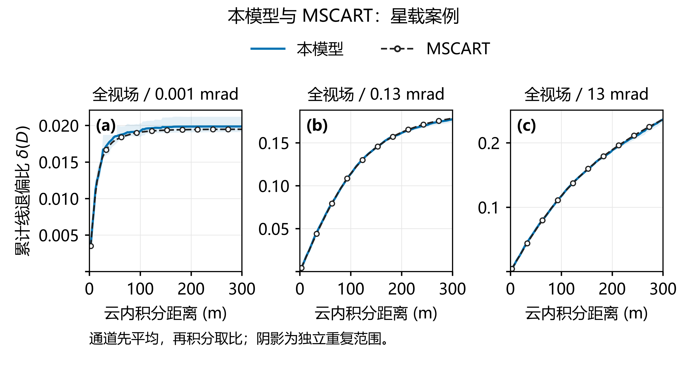

# MUltiple Scattering Simulator (MUSS)

MUSS is a MATLAB-based simulator for multiple scattering of polarized lidar beams in water clouds. It combines Mie scattering theory, cloud droplet size distributions, and a semi-analytical Monte Carlo method to simulate laser propagation, scattering, and polarization evolution within clouds. Return Stokes signals are accumulated by range bin to calculate return intensity and the linear depolarization ratio.

The project provides CPU and GPU implementations, along with comparison data for ground-based and spaceborne lidar cases using reference results generated with the third-party MSCART model.

## Features

- **Polarized multiple scattering:** Tracks photon propagation, scattering, absorption, and polarization evolution in water clouds, using semi-analytical estimates to accumulate the received signal.
- **Layered cloud configurations:** Supports layer-specific effective radii, modified gamma distribution shape parameters, and extinction coefficients or cloud droplet number concentrations.
- **CPU and GPU computation:** Both implementations share optical preprocessing, Mie scattering data, and Mueller scattering matrix definitions.
- **Return signals and diagnostics:** Outputs return Stokes signals and diagnostics such as layer-resolved signals and scattering-order contributions.
- **Reference comparisons:** Includes saved MUSS and MSCART results and a Python plotting script for ground-based and spaceborne cases.

## Requirements

| Usage | Requirements |
| --- | --- |
| CPU simulation | MATLAB |
| GPU simulation | MATLAB, Parallel Computing Toolbox, and a GPU supported by MATLAB |

## Installation and Setup

Clone the `master` branch:

```bash
git clone --branch master https://github.com/ZPYin/MultiScatterSim.git
cd MultiScatterSim
```

In MATLAB, set the current folder to the project root and run:

```matlab
setupMSToolbox
```

This script adds `lib/`, `include/`, and `tests/`, including their subdirectories, to the MATLAB search path.

## Quick Start

Run the following commands in MATLAB with the project root as the current folder.

### CPU Example

```matlab
run(fullfile('analysis', 'MCSim.m'))
```

This example configures a 532 nm lidar and a layered water cloud, simulates 10,000 photons using the CPU model, and displays diagnostic plots. Edit the lidar configuration `lidarCfg`, cloud configuration `cloudCfg`, and photon count `nPhoton` in [MCSim.m](analysis/MCSim.m) to adjust the simulation.

### GPU Example

```matlab
run(fullfile('analysis', 'MCSimGPU.m'))
```

This example uses the same lidar and cloud configurations as the CPU example and simulates 10,000 photons using the GPU model. It sets `fallbackToCPU=false`, so a working GPU computing environment is required.

See the [GPU model documentation](lib/MC_GPU/README.md) for GPU parameters and implementation details.

### Scattering Database

Both examples use the [sample Mie scattering database](data/water_cloud_scattering_phase_function_example.mat) included in the repository. Its path is resolved automatically.

A compatible alternative database can be specified with the `scatMatrixFile` parameter. Use [water_droplet_scattering_gen.m](lib/scattering-phase-function/water_droplet_scattering_gen.m) to generate scattering databases.

## Model Inputs and Outputs

The model takes two main configuration structures:

| Input | Main parameters |
| --- | --- |
| `lidarCfg` | Wavelength, beam radius and divergence, receiver field of view, telescope radius, range-bin settings, and incident Stokes vector |
| `cloudCfg` | Cloud base height, layer thickness and number of layers, effective radius, size distribution shape parameters, and extinction coefficient or cloud droplet number concentration |

Cloud optical properties can be configured in two ways:

- **Extinction coefficient mode:** Configures the cloud using `cloudCfg.clExt`, `cloudCfg.clReff`, and `cloudCfg.kappa`.
- **Droplet number concentration mode:** Uses `cloudCfg.N_d`, `cloudCfg.clReff`, and `cloudCfg.kappa` to define the droplet size distribution, then combines it with Mie data to calculate optical properties at the specified wavelength. `N_d` is expressed in `m^-3`. This mode takes precedence when a nonempty `N_d` is supplied.

After defining `lidarCfg` and `cloudCfg`, call the model to obtain its outputs:

```matlab
[SVReturn, diag] = MSMCSim(lidarCfg, cloudCfg, ...
    'nPhoton', 1e4, 'visible', 'off');
```

The GPU entry point `MSMCSimGPU` uses the same main inputs and output structure. `SVReturn` is a `4 × nBins` array of return Stokes signals, with rows corresponding to `I`, `Q`, `U`, and `V`. `diag` contains diagnostic information.

The parallel and perpendicular polarization channels and the linear depolarization ratio are defined as:

```text
I_parallel      = (I + Q) / 2
I_perpendicular = (I - Q) / 2
delta           = I_perpendicular / I_parallel
```

See the [MUSS model principles](docs/MUSS基本原理介绍.md) for detailed parameters, units, and computational procedures.

## Comparison with MSCART Reference Data

The project includes ground-based and spaceborne cases comparing MUSS simulation results with reference data generated using the third-party MSCART model. MSCART source code and executables are not distributed with this repository.

### Ground-Based Case

This case uses a 355 nm wavelength and 5 m range bins to compare cumulative linear depolarization ratios under low and high extinction conditions, with full-angle fields of view of 0.5 and 2.0 mrad. The figure shows integration depths within the cloud up to 150 m.

<p align="center">
  
</p>

### Spaceborne Case

This case uses a 532 nm wavelength and 3 m range bins to compare cumulative linear depolarization ratios at full-angle fields of view of 0.001, 0.13, and 13 mrad. The figure shows integration depths within the cloud up to 300 m.

<p align="center">
  
</p>

In both figures, blue solid lines show MUSS results, while black dashed lines with circular markers show MSCART reference data. Each polarization channel is averaged across independent repeats before accumulation and ratio calculation. Shaded bands show the range across independent repeats.

The comparison directory contains saved results from both models, comparison figures and tables, and the `compare.py` plotting script. Plotting uses the saved data directly. See the [MSCART comparison data guide](analysis/mscart_comparison/README.md) for instructions.

## Documentation and Examples

| Document or example | Contents |
| --- | --- |
| [MUSS model principles](docs/MUSS基本原理介绍.md) | Semi-analytical Monte Carlo workflow, cloud optical properties, inputs and outputs, and depolarization ratio calculations |
| [GPU model documentation](lib/MC_GPU/README.md) | GPU implementation, correspondence between CPU and GPU physical processes, and computation modes |
| [Shared optical preprocessing](lib/MC_Optics/README.md) | Cloud optical property calculations, reuse of preprocessed data, and caching |
| [MSCART comparison data guide](analysis/mscart_comparison/README.md) | Ground-based and spaceborne reference data, statistical definitions, and plotting instructions |
| [Single-layer cloud depolarization example](analysis/depolarization_ration_cmp.m) | Variation of the linear depolarization ratio with cloud penetration depth at different extinction coefficients |

## Main Modules

| Module | Purpose |
| --- | --- |
| `lib/MC/MSMCSim.m` | Main CPU semi-analytical polarized Monte Carlo model |
| `lib/MC_GPU/MSMCSimGPU.m` | Public entry point for the GPU model |
| `lib/MC_Optics/prepareMSMCOptics.m` | Cloud optical preprocessing shared by CPU and GPU implementations |
| `lib/MC_Optics/prepareMSMCOpticsCached.m` | Reuse and caching of optical preprocessing results |
| `lib/scattering-phase-function/cloudScatteringMatrix.m` | Mueller scattering matrices and optical coefficients averaged over the cloud droplet size distribution |
| `lib/scattering-phase-function/water_droplet_scattering_gen.m` | Generation of water droplet Mie scattering databases |
| `lib/cloud-microphysics/smmgDist.m` | Modified gamma cloud droplet size distribution |
| `lib/cloud-optics/refIdxWater.m` | Complex refractive index of water |

## Developer Team

| Name | Affiliation | Email |
| --- | --- | --- |
| Zhenping Yin | Wuhan University | zp.yin@whu.edu.cn |
| Chengwei Luo | Hubei University | cw.luo@stu.hubu.edu.cn |
