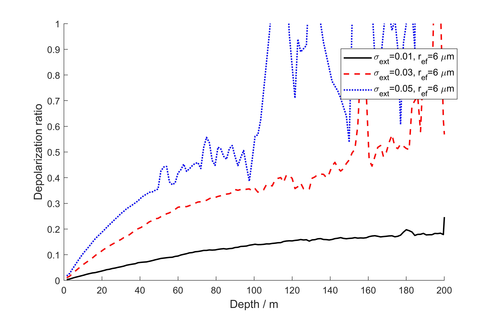
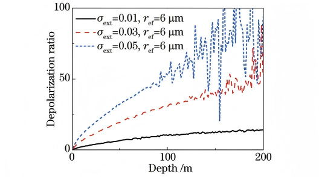
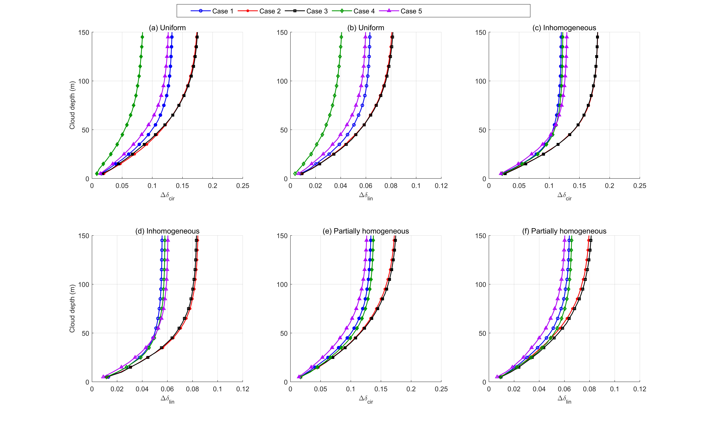
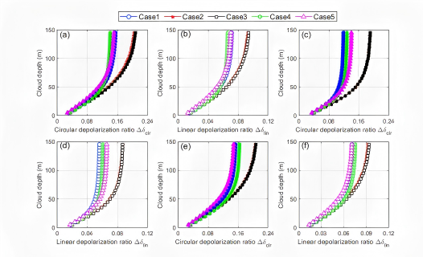

# MUltiple Scattering Simulator (MUSS)

MUSS 是一个基于 MATLAB 的云层多次散射模拟程序，主要用于模拟激光在水云中的传播、散射和偏振演化过程。程序结合 Mie 散射理论、云滴粒径谱和蒙特卡洛光子传输方法，可计算激光在云层内发生多次散射后被接收系统探测到的回波 Stokes 信号、回波强度和线偏振退偏比等结果。

## 主要模块

| 模块 | 说明 |
|---|---|
| `lib/MC/MSMCSim.m` | 蒙特卡洛多次散射主程序 |
| `lib/MC_GPU/MSMCSimGPU.m` | GPU 多次散射公共入口 |
| `lib/MC_Optics/prepareMSMCOptics.m` | CPU/GPU 共用的云光学预处理 |
| `lib/MC/freeRunning.m` | 云层中光子的自由程采样 |
| `lib/MC/updateDir.m` | 光子散射后的传播方向更新 |
| `lib/MC/rotSVPhi.m` | Stokes 向量旋转 |
| `lib/scattering-phase-function/cloudScatteringMatrix.m` | 云层体平均 Mueller 散射矩阵和光学参数计算 |
| `lib/scattering-phase-function/water_droplet_scattering_gen.m` | 水滴 Mie 散射数据库生成函数 |
| `lib/cloud-microphysics/smmgDist.m` | 修正 Gamma 云滴粒径谱计算 |
| `lib/cloud-optics/refIdxWater.m` | 水的复折射率计算 |

## 下载

首先克隆仓库：

```bash
git clone https://github.com/ZPYin/MultiScatterSim.git
```

进入项目根目录：

```bash
cd MultiScatterSim-dev
```

在 MATLAB 中打开项目根目录，并运行：

```matlab
setupMSToolbox
```

该脚本会将 `lib/`、`include/`、`analysis/` 和 `tests/` 等目录加入 MATLAB 搜索路径。

## 运行示例

可以参考：

```text
analysis/MCSim.m
```

该脚本配置仿真输入参数，并调用 `MSMCSim.m` 主程序运行多次散射模拟。

GPU 最小运行示例为：

```text
analysis/MCSimGPU.m
```

GPU 版本需要 MATLAB Parallel Computing Toolbox 和受支持的 GPU。CPU 与 GPU
示例使用仓库自带的同一份 Mie 散射示例数据库和同一套光学预处理，默认文件为：

```text
data/water_cloud_scattering_phase_function_example.mat
```

两个最小示例无需显式传入数据库路径；`prepareMSMCOptics` 会自动使用上述默认位置。
正式计算也可以通过 `scatMatrixFile` 显式指定其他兼容的高分辨率数据库。

GPU 模式的运行参数、CPU/GPU 物理过程对应关系及模块结构详见：

[`lib/MC_GPU/README.md`](./lib/MC_GPU/README.md)

若需要运行单层云退偏比验证示例，可参考：

```text
analysis/depolarization_ration_cmp.m
```

Mie 散射数据库可根据仿真需求自行生成，相关函数为：

```text
lib/scattering-phase-function/water_droplet_scattering_gen.m
```

## 云层多次散射结果展示

<p align="center">
  
</p>

<p align="center">
  
</p>

<p align="center">
  
</p>

<p align="center">
  
</p>

## 多次散射模型基本原理

多次散射模型的详细原理说明见：

[《MUSS 基本原理介绍》](./docs/MUSS基本原理介绍.md)

该文档介绍了 `MSMCSim.m` 的主程序流程、云层散射矩阵计算、`clExt/sigma_e` 驱动模式、`N_d + R_eff` 云微物理参数驱动模式，以及输出回波信号和退偏比的计算方法。

## Developer Team

| Name | Department | Email |
|:--:|:--:|:--:|
| Zhenping Yin | Wuhan University | zp.yin@whu.edu.cn |
| Chenwei Luo | Hubei University | cw.luo@stu.hubu.edu.cn |
