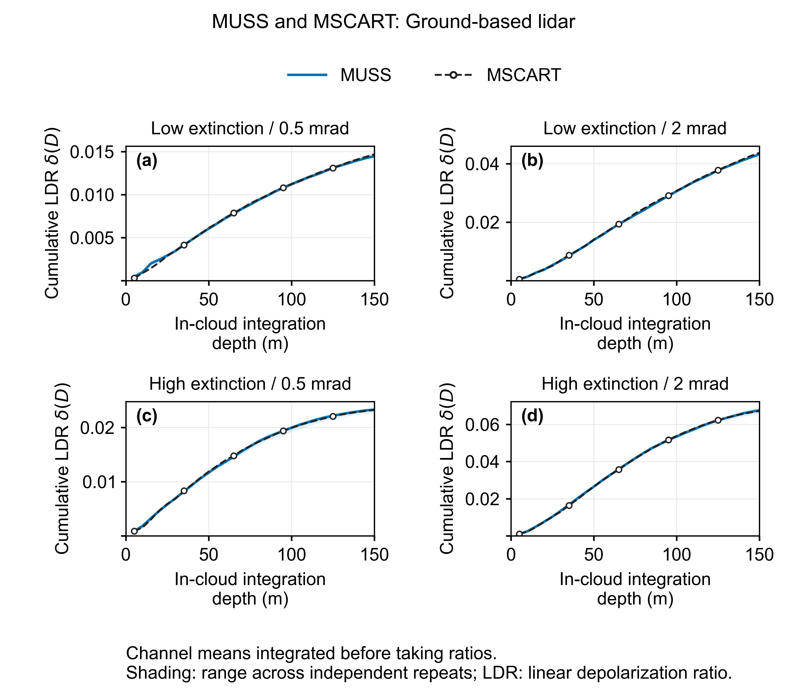
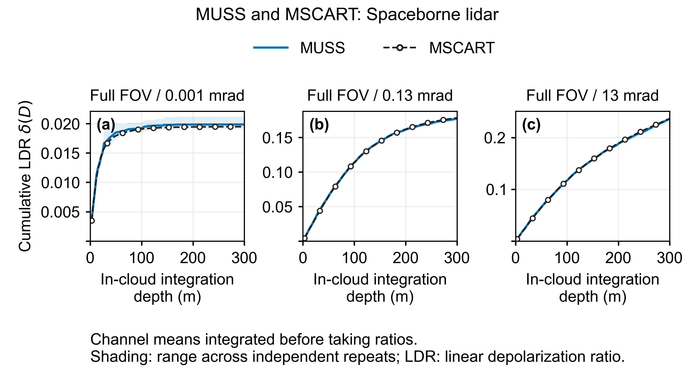

# MUltiple Scattering Simulator (MUSS)

MUSS is a MATLAB-based simulator for multiple scattering of polarized lidar beams in water clouds. It combines Mie scattering and semi-analytical Monte Carlo methods to calculate return Stokes signals, intensity, and the linear depolarization ratio.

The model supports layered clouds parameterized by extinction coefficients or droplet number concentrations. Its CPU and GPU implementations share the same optical preprocessing.

## Quick Start

CPU simulations require MATLAB. GPU simulations additionally require Parallel Computing Toolbox and a GPU supported by MATLAB.

Clone the `master` branch:

```bash
git clone --branch master https://github.com/ZPYin/MultiScatterSim.git
cd MultiScatterSim
```

In MATLAB, set the current folder to the project root, then initialize the toolbox and run the CPU example:

```matlab
setupMSToolbox
run(fullfile('analysis', 'MCSim.m'))
```

To run the GPU example:

```matlab
run(fullfile('analysis', 'MCSimGPU.m'))
```

Both examples use a 532 nm wavelength, 10,000 photons, and the included [sample scattering database](data/water_cloud_scattering_phase_function_example.mat). Adjust `lidarCfg`, `cloudCfg`, and `nPhoton` in the example scripts to change the simulation settings.

See the [model principles and parameters](docs/MUSS基本原理介绍.md) for input parameters, output formats, and depolarization ratio definitions.

## Comparison with MSCART

Ground-based and spaceborne cases compare MUSS results with reference data generated using the third-party MSCART model. MSCART source code and executables are not distributed with this repository.

### Ground-Based Case

355 nm wavelength, 5 m range bins, low and high extinction conditions, and full-angle fields of view of 0.5 and 2.0 mrad. The figure shows cumulative linear depolarization ratios for integration depths up to 150 m within the cloud.

<p align="center">
  
</p>

### Spaceborne Case

532 nm wavelength, 3 m range bins, and full-angle fields of view of 0.001, 0.13, and 13 mrad. The figure shows cumulative linear depolarization ratios for integration depths up to 300 m within the cloud.

<p align="center">
  
</p>

Blue solid lines show MUSS results; black dashed lines with circular markers show MSCART reference data. Each polarization channel is averaged across independent repeats before accumulation and ratio calculation. Shaded bands show the range across independent repeats.

See the [MSCART comparison guide](analysis/mscart_comparison/README.md) for saved data, statistical definitions, and plotting instructions.

## Documentation and Examples

| Document | Contents |
| --- | --- |
| [Model principles and parameters](docs/MUSS基本原理介绍.md) | Physical processes, inputs and outputs, examples, and module index |
| [GPU model](lib/MC_GPU/README.md) | GPU requirements, implementation, and photon state layouts |
| [Optical preprocessing](lib/MC_Optics/README.md) | Scattering databases, optical preprocessing, and caching |
| [MSCART comparison](analysis/mscart_comparison/README.md) | Reference data and comparison plots |
| [Single-layer cloud example](analysis/depolarization_ration_cmp.m) | Depolarization ratio versus cloud penetration depth at different extinction coefficients |

## Developer Team

| Name | Affiliation | Email |
| --- | --- | --- |
| Zhenping Yin | Wuhan University | zp.yin@whu.edu.cn |
| Chengwei Luo | Hubei University | cw.luo@stu.hubu.edu.cn |
