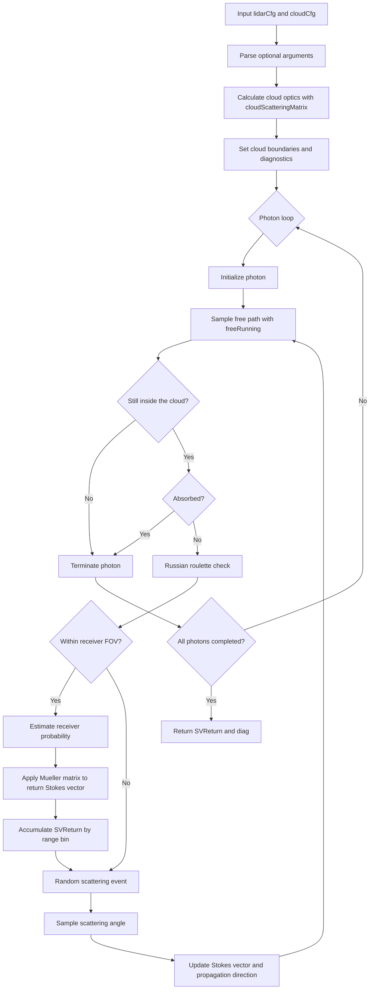

# Principles of the MUSS Multiple Scattering Model

This document describes the Monte Carlo model for multiple scattering of polarized lidar beams in MultiScatterSim. It covers the workflow of `MSMCSim.m`, the construction of cloud optical properties, and the cloud microphysical parameterization based on `N_d + R_eff`.

## Monte Carlo Multiple Scattering

Monte Carlo (MC) multiple scattering is a statistical simulation method based on photon random walks. The incident laser beam is represented by many independent photon packets, whose propagation through the cloud is tracked through the following processes:

- Photon launch and initialization of the polarization state;
- Free-path sampling within the cloud;
- Sampling of scattering locations and angles;
- Stokes vector updates using Mueller matrices;
- Photon absorption, escape, and evaluation of receiver contributions within the telescope field of view;
- Accumulation of return Stokes signals by range bin.

Accumulating the contributions of many photon packets yields observables such as lidar return intensity, Stokes components, and the linear depolarization ratio.

`MSMCSim.m` uses a semi-analytical Monte Carlo approach. At each scattering event, it estimates the contribution from scattering toward the telescope within the receiver field of view, while continuing the random photon trajectory. This improves the statistical efficiency of the backscatter estimate.

## Overall Workflow

The workflow of `MSMCSim.m` is summarized below:



`SVReturn` contains the return Stokes signals, and `diag` contains diagnostics such as layer-resolved returns and scattering-count distributions.

## 1. Cloud Optical Properties

`cloudScatteringMatrix.m` reads a precomputed water droplet Mie scattering database and combines it with the cloud droplet size distribution to obtain bulk scattering matrices and optical coefficients for each cloud layer.

The main outputs are:

- `muExt`: bulk extinction coefficient, in `m^-1`;
- `muSca`: bulk scattering coefficient, in `m^-1`;
- `S11, S12, S33, S34`: bulk Mueller scattering matrix elements;
- `theta`: scattering-angle grid.

For a cloud droplet size distribution `n(r)`, the bulk extinction coefficient at wavelength `lambda` is:

$$
\mu_{ext}(\lambda)=\int \pi r^2 Q_{ext}(\lambda,r)n(r)\,dr
$$

Here, `Q_ext(lambda,r)` is obtained from the Mie scattering database, and `n(r)` is calculated from the droplet size distribution function.

## 2. Cloud Parameterization Modes

Cloud optical properties can be constructed using either of the following parameterizations.

### 2.1 Extinction-Based Mode: `clExt / sigma_e`

The input extinction parameter `clExt`, passed to `cloudScatteringMatrix` as `sigma_e`, is used with `R_eff` and `kappa` to infer the droplet number concentration.

**Implementation detail:** `smmgDist.m` uses an extinction-based approximation to infer the number concentration. When the database provides `Qext` and `Qsca`, `cloudScatteringMatrix.m` subsequently computes `muExt` and `muSca` by Mie integration. The returned `muExt` therefore need not equal the input `clExt` exactly.

This mode is useful for single-wavelength studies, such as examining the relationship between extinction, droplet size, and depolarization at 532 nm.

Typical inputs are:

```matlab
cloudCfg.clExt = 0.02;   % m^-1
cloudCfg.clReff = 8;     % um
cloudCfg.kappa = 7;
```

### 2.2 Number-Concentration Mode: `N_d + R_eff`

This mode takes cloud microphysical parameters as inputs: droplet number concentration `N_d`, effective radius `R_eff`, and size distribution shape parameter `kappa`. These parameters first determine `n(r)`. Mie integration then gives the wavelength-dependent `muExt`, `muSca`, and Mueller matrices.

This mode is suited to studying the response of the same cloud at different wavelengths. The droplet number concentration and size distribution remain fixed across wavelengths, while the optical properties vary according to Mie scattering.

Typical inputs are:

```matlab
cloudCfg.N_d = 100 * 1e6;  % 100 cm^-3 -> m^-3
cloudCfg.clReff = 6;       % um
cloudCfg.kappa = 7;
```

When `cloudCfg` contains a nonempty `N_d` field, `MSMCSim.m` uses the `N_d + R_eff` mode. Otherwise, it uses the `clExt / sigma_e` mode.

## 3. Modified Gamma Droplet Size Distribution

The model uses a modified gamma distribution to describe cloud droplet sizes. Given `N_d`, `R_eff`, and `kappa`, the size distribution is:

$$
n(r)=\frac{N_d}{R_m\Gamma(\kappa)}\left(\frac{r}{R_m}\right)^{\kappa-1}\exp\left(-\frac{r}{R_m}\right)
$$

The scale parameter `R_m` depends on `R_eff` and `kappa`. The distribution is generated by `smmgDist.m`.

In the `clExt / sigma_e` mode, `smmgDist.m` infers `N_d` from the input `sigma_e`. In the `N_d + R_eff` mode, the explicitly supplied number concentration is used directly to construct the size distribution.

## 4. Input Parameters of MSMCSim.m

### 4.1 Lidar Configuration: `lidarCfg`

| Parameter | Description | Unit |
| --- | --- | --- |
| `lambda` | Incident laser wavelength | nm |
| `rBeam` | Transmitted beam radius | mm |
| `divBeam` | Beam divergence | mrad |
| `FOV` | Receiver field of view | mrad |
| `rTel` | Telescope radius | mm |
| `binWidth` | Time-bin width | ns |
| `nBins` | Number of range bins | - |
| `distBeamTel` | Separation between the transmitter and receiver optical axes | mm |
| `SBeam` | Incident Stokes vector | - |

Example:

```matlab
lidarCfg.lambda = 532;
lidarCfg.rBeam = 5;
lidarCfg.divBeam = 0.05;
lidarCfg.FOV = 1;
lidarCfg.rTel = 150;
lidarCfg.binWidth = 20;
lidarCfg.nBins = 100;
lidarCfg.distBeamTel = 50;
lidarCfg.SBeam = [1; 1; 0; 0];
```

### 4.2 Cloud Configuration: `cloudCfg`

| Parameter | Description | Unit |
| --- | --- | --- |
| `clBase` | Cloud base height | m |
| `clDh` | Geometrical thickness of each cloud layer | m |
| `nClLayers` | Number of cloud layers | - |
| `kappa` | Modified gamma distribution shape parameter | - |
| `clReff` | Effective droplet radius | um |
| `clExt` | Extinction parameter for the extinction-based mode | m^-1 |
| `N_d` | Droplet number concentration for the concentration-based mode | m^-3 |

Example using the `clExt / sigma_e` mode:

```matlab
cloudCfg.clBase = 1000;
cloudCfg.clDh = 100;
cloudCfg.nClLayers = 1;
cloudCfg.kappa = 7;
cloudCfg.clReff = 6;
cloudCfg.clExt = 0.02;
```

Example using the `N_d + R_eff` mode:

```matlab
cloudCfg.clBase = 1000;
cloudCfg.clDh = 100;
cloudCfg.nClLayers = 1;
cloudCfg.kappa = 7;
cloudCfg.clReff = 6;
cloudCfg.N_d = 100 * 1e6;  % 100 cm^-3
```

## 5. Calling MSMCSim.m

Basic call:

```matlab
SVReturn = MSMCSim(lidarCfg, cloudCfg);
```

Disable plotting for batch simulations:

```matlab
[SVReturn, diag] = MSMCSim(lidarCfg, cloudCfg, ...
    'nPhoton', 1e5, ...
    'visible', 'off');
```

To specify a scattering database:

```matlab
[SVReturn, diag] = MSMCSim(lidarCfg, cloudCfg, ...
    'scatMatrixFile', 'data/water_cloud_scattering_phase_function_example.mat', ...
    'visible', 'off');
```

To compare the response of the same cloud at different wavelengths, keep `cloudCfg.N_d`, `cloudCfg.clReff`, and `cloudCfg.kappa` fixed and vary `lidarCfg.lambda`:

**Database requirement:** The four-wavelength example below requires a database covering all four wavelengths. The bundled sample covers 355, 532, and 1064 nm. The 1550 nm case requires a compatible database supplied through `scatMatrixFile`, as illustrated in the preceding call.

```matlab
wavelengths = [355, 532, 1064, 1550];

cloudCfg.N_d = 100 * 1e6;
cloudCfg.clReff = 6;
cloudCfg.kappa = 7;

SVReturn = cell(size(wavelengths));
diag = cell(size(wavelengths));
for i = 1:numel(wavelengths)
    lidarCfg.lambda = wavelengths(i);
    [SVReturn{i}, diag{i}] = MSMCSim(lidarCfg, cloudCfg, ...
        'nPhoton', 1e5, ...
        'visible', 'off');
end
```

The four wavelengths correspond to the same cloud microphysical parameters. Differences in the returns arise from the wavelength dependence of Mie scattering efficiencies, phase functions, and polarization matrices.

## 6. Return Signals and Depolarization Ratio

`MSMCSim.m` returns `SVReturn` as a `4 x nBins` matrix:

| Row | Stokes component | Description |
| --- | --- | --- |
| 1 | `I` | Total intensity |
| 2 | `Q` | Difference between horizontal and vertical linear polarization components |
| 3 | `U` | Difference between the 45-degree and 135-degree linear polarization components |
| 4 | `V` | Difference between right- and left-circular polarization components |

The linear depolarization ratio can be calculated from `I` and `Q`:

$$
P_{\parallel}=\frac{I+Q}{2},\qquad P_{\perp}=\frac{I-Q}{2}
$$

$$
\delta_{lin}(z)=\frac{P_{\perp}(z)}{P_{\parallel}(z)}=\frac{I(z)-Q(z)}{I(z)+Q(z)}
$$

## 7. Diagnostic Output: `diag`

`diag` contains the following diagnostic quantities:

| Field | Description |
| --- | --- |
| `SVReturnLayer` | Return Stokes contributions from each cloud layer |
| `layerI` | Total return intensity from each layer |
| `nScasHistEdges` | Bin edges of the scattering-count histogram |
| `nScasHist` | Counts in the scattering-count histogram |
| `layerScatterCount` | Number of scattering events recorded in each layer |
| `angleSampler` | Selected scattering-angle sampling method |

These quantities help assess scattering orders, layer contributions, and Monte Carlo statistical stability.

## 8. Usage Notes

1. The `clExt / sigma_e` mode can be used for single-wavelength validation or reproduction studies.
2. Prefer the `N_d + R_eff` mode when studying the same cloud at multiple wavelengths.
3. `N_d` is expressed in `m^-3`. Multiply values in `cm^-3` by `1e6` before supplying them to the model.
4. Large optical depths can reduce the statistical quality of the returns. Increase `nPhoton` or narrow the parameter range under study as needed.
5. For batch generation of two-dimensional lookup tables, set `'visible','off'` and save intermediate results.

`MSMCSim.m` combines lidar and cloud configurations with a Mie scattering database and Monte Carlo photon tracking to simulate polarized lidar returns from multiple scattering within clouds.

The `N_d + R_eff` mode supports studies of wavelength-dependent return intensity and depolarization for the same cloud microphysical state, providing a forward model for subsequent multiwavelength polarized lidar retrieval studies.

## Implementation Modules

| Module | Purpose |
| --- | --- |
| [MSMCSim.m](../lib/MC/MSMCSim.m) | CPU semi-analytical polarized Monte Carlo model |
| [MSMCSimGPU.m](../lib/MC_GPU/MSMCSimGPU.m) | Public GPU entry point |
| [prepareMSMCOptics.m](../lib/MC_Optics/prepareMSMCOptics.m) | Optical preprocessing shared by the CPU and GPU backends |
| [prepareMSMCOpticsCached.m](../lib/MC_Optics/prepareMSMCOpticsCached.m) | Reuse and caching of optical preprocessing results |
| [cloudScatteringMatrix.m](../lib/scattering-phase-function/cloudScatteringMatrix.m) | Bulk Mueller matrices and optical coefficients |
| [water_droplet_scattering_gen.m](../lib/scattering-phase-function/water_droplet_scattering_gen.m) | Water droplet Mie scattering database generation |
| [smmgDist.m](../lib/cloud-microphysics/smmgDist.m) | Modified gamma droplet size distribution |
| [refIdxWater.m](../lib/cloud-optics/refIdxWater.m) | Complex refractive index of water |
