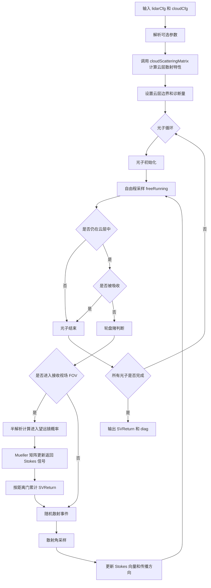

# MUSS 多次散射模型基本原理介绍

本文档用于说明 MultiScatterSim 中基于蒙特卡洛方法的偏振激光雷达多次散射模型。重点介绍主程序 `MSMCSim.m` 的计算流程、云层光学参数的构造方式，以及新增的 `N_d + R_eff` 云微物理参数驱动模式。

## 蒙特卡洛多次散射基本原理

蒙特卡洛（Monte Carlo, MC）多次散射方法是一种基于光子随机游走的统计模拟方法。其核心思想是将入射激光看作大量相互独立的光子包，逐个追踪光子在云层介质中的传播过程，包括：

- 光子发射与初始偏振态设置；
- 云层中的自由程采样；
- 散射事件位置和散射角采样；
- Mueller 矩阵更新 Stokes 向量；
- 光子吸收、逃逸或被望远镜视场接收；
- 按距离门累计回波 Stokes 信号。

最终通过统计大量光子的返回信号，可以得到激光雷达回波强度、Stokes 分量以及线偏振退偏比等观测量。

本项目中的 `MSMCSim.m` 采用半解析蒙特卡洛思想。在每次散射事件处，除继续随机追踪光子外，还额外计算光子向望远镜方向散射并进入接收视场的概率，从而提高后向回波信号的统计效率。

## 主程序总体流程

`MSMCSim.m` 的总体流程可以概括为：



其中，`SVReturn` 是最终的回波 Stokes 信号，`diag` 保存分层回波、散射次数分布等诊断信息。

## 1.云层光学参数计算

云层散射特性的计算由 `cloudScatteringMatrix.m` 完成。该函数读取预先计算好的水滴 Mie 散射数据库，并结合云滴粒径分布，得到每一层云的体平均散射矩阵和光学系数。

主要输出包括：

- `muExt`：体消光系数，单位为 `m^-1`；
- `muSca`：体散射系数，单位为 `m^-1`；
- `S11, S12, S33, S34`：体平均 Mueller 散射矩阵元素；
- `theta`：散射角网格。

对于一组云滴粒径分布 `n(r)`，不同波长下的体消光系数可表示为：

$$
\mu_{ext}(\lambda)=\int \pi r^2 Q_{ext}(\lambda,r)n(r)\,dr
$$

其中，`Q_ext(lambda,r)` 来自 Mie 散射数据库，`n(r)` 由云滴谱分布函数给出。

## 2. 两种云层参数驱动模式

当前代码中云层光学参数可以通过两种方式构造。

### 2.1 `clExt / sigma_e` 驱动

以输入的消光系数 `clExt`，也就是传入 `cloudScatteringMatrix` 的 `sigma_e`，作为控制量。代码根据给定的 `sigma_e`、`R_eff` 和 `kappa` 反向确定云滴数浓度，使当前波长下云层消光系数满足输入值。

这种模式适合单波长情形，例如只研究 532 nm 下消光系数、粒径和退偏比之间的关系。

典型输入为：

```matlab
cloudCfg.clExt = 0.02;   % m^-1
cloudCfg.clReff = 8;     % um
cloudCfg.kappa = 7;
```

### 2.2 `N_d + R_eff` 驱动

以云微物理参数作为输入，即云滴数浓度 `N_d`、有效半径 `R_eff` 和谱形参数 `kappa`。在这种模式下，云滴谱 `n(r)` 首先由微物理参数确定，然后不同波长分别通过 Mie 积分计算对应的 `muExt`、`muSca` 和 Mueller 矩阵。

这种模式更适合研究“同一片云在不同波长激光入射下的响应”。因为此时同一片云应具有相同的云滴数浓度和粒径分布，而不是让每个波长重新调节数浓度以满足同一个输入消光系数。

典型输入为：

```matlab
cloudCfg.N_d = 100 * 1e6;  % 100 cm^-3 -> m^-3
cloudCfg.clReff = 6;       % um
cloudCfg.kappa = 7;
```

当 `cloudCfg` 中存在非空 `N_d` 字段时，`MSMCSim.m` 会优先采用 `N_d + R_eff` 模式；否则回退到旧的 `clExt / sigma_e` 模式。

## 3. 修正伽马云滴谱

项目中常用修正伽马分布描述云滴粒径谱。给定数浓度 `N_d`、有效半径 `R_eff` 和形状参数 `kappa` 后，可以构造粒径谱：

$$
n(r)=\frac{N_d}{R_m\Gamma(\kappa)}\left(\frac{r}{R_m}\right)^{\kappa-1}\exp\left(-\frac{r}{R_m}\right)
$$

其中 `R_m` 与 `R_eff` 和 `kappa` 有关。`smmgDist.m` 负责生成该粒径谱。

在`clExt / sigma_e` 驱动模式中，`smmgDist.m` 由输入的 `sigma_e` 反推 `N_d`；在`N_d + R_eff` 驱动模式中，若用户显式输入 `N_d`，则直接使用该真实数浓度构造粒径谱。

## 4. MSMCSim.m 输入参数

### 4.1 激光雷达参数 `lidarCfg`

| 参数 | 含义 | 单位 |
|---|---|---|
| `lambda` | 入射激光波长 | nm |
| `rBeam` | 发射光束半径 | mm |
| `divBeam` | 发射光束发散角 | mrad |
| `FOV` | 接收视场角 | mrad |
| `rTel` | 望远镜半径 | mm |
| `binWidth` | 距离门宽度 | ns |
| `nBins` | 距离门数量 | - |
| `distBeamTel` | 发射光轴与接收光轴间距 | mm |
| `SBeam` | 入射 Stokes 向量 | - |

示例：

```matlab
lidarCfg.lambda = 532;
lidarCfg.rBeam = 5;
lidarCfg.divBeam = 0.05;
lidarCfg.FOV = 1;
lidarCfg.rTel = 150;
lidarCfg.binWidth = 20;
lidarCfg.nBins = 100;
lidarCfg.distBeamTel = 50;
lidarCfg.SBeam = [1; 1; 0; 0];
```

### 4.2 云层参数 `cloudCfg`

| 参数 | 含义 | 单位 |
|---|---|---|
| `clBase` | 云底高度 | m |
| `clDh` | 单层云几何厚度 | m |
| `nClLayers` | 云层数 | - |
| `kappa` | 修正伽马分布形状参数 | - |
| `clReff` | 有效粒子半径 | um |
| `clExt` | 消光系数，旧模式使用 | m^-1 |
| `N_d` | 云滴数浓度，新模式使用 | m^-3 |

`N_d + R_eff`模式示例：

```matlab
cloudCfg.clBase = 1000;
cloudCfg.clDh = 100;
cloudCfg.nClLayers = 1;
cloudCfg.kappa = 7;
cloudCfg.clReff = 6;
cloudCfg.clExt = 0.02;
```

`N_d + R_eff`模式示例：

```matlab
cloudCfg.clBase = 1000;
cloudCfg.clDh = 100;
cloudCfg.nClLayers = 1;
cloudCfg.kappa = 7;
cloudCfg.clReff = 6;
cloudCfg.N_d = 100 * 1e6;  % 100 cm^-3
```

## 5. MSMCSim.m 调用方式

最基本调用方式为：

```matlab
SVReturn = MSMCSim(lidarCfg, cloudCfg);
```

推荐在批量仿真时关闭图像显示：

```matlab
[SVReturn, diag] = MSMCSim(lidarCfg, cloudCfg, ...
    'nPhoton', 1e5, ...
    'visible', 'off');
```

如果需要指定散射数据库：

```matlab
[SVReturn, diag] = MSMCSim(lidarCfg, cloudCfg, ...
    'scatMatrixFile', 'data/water_cloud_scattering_phase_function_example.mat', ...
    'visible', 'off');
```

如果要比较同一片云对不同波长的响应，可以固定 `cloudCfg.N_d`、`cloudCfg.clReff` 和 `cloudCfg.kappa`，只改变 `lidarCfg.lambda`：

```matlab
wavelengths = [355, 532, 1064, 1550];

cloudCfg.N_d = 100 * 1e6;
cloudCfg.clReff = 6;
cloudCfg.kappa = 7;

for i = 1:numel(wavelengths)
    lidarCfg.lambda = wavelengths(i);
    [SVReturn{i}, diag{i}] = MSMCSim(lidarCfg, cloudCfg, ...
        'nPhoton', 1e5, ...
        'visible', 'off');
end
```

此时四个波长对应的是同一组云滴微物理参数，差异来自 Mie 散射效率、相函数和偏振矩阵的波长依赖。

## 6. 回波信号和退偏比计算

`MSMCSim.m` 输出的 `SVReturn` 为 `4 x nBins` 矩阵：

| 行号 | Stokes 分量 | 含义 |
|---|---|---|
| 1 | `I` | 总强度 |
| 2 | `Q` | 水平与垂直线偏振分量之差 |
| 3 | `U` | 45° 与 135° 线偏振分量之差 |
| 4 | `V` | 右旋与左旋圆偏振分量之差 |

常用线偏振退偏比可以由 `I` 和 `Q` 计算：

$$
P_{\parallel}=\frac{I+Q}{2},\qquad P_{\perp}=\frac{I-Q}{2}
$$

$$
\delta_{lin}(z)=\frac{P_{\perp}(z)}{P_{\parallel}(z)}=\frac{I(z)-Q(z)}{I(z)+Q(z)}
$$


## 7. 诊断输出 `diag`

`diag` 保存若干辅助诊断量：

| 字段 | 含义 |
|---|---|
| `SVReturnLayer` | 各云层贡献的 Stokes 回波 |
| `layerI` | 每层回波强度总和 |
| `nScasHistEdges` | 散射次数直方图边界 |
| `nScasHist` | 散射次数直方图计数 |
| `layerScatterCount` | 每层发生的散射事件数量 |
| `angleSampler` | 当前使用的散射角采样方法 |

这些诊断量可用于判断多次散射阶数、分层贡献和 MC 统计稳定性。

## 8. 使用建议

1. 单波长验证或复现实验时，可以使用 `clExt / sigma_e` 模式。
2. 多波长同一云层响应研究时，应优先使用 `N_d + R_eff` 模式。
3. `N_d` 的单位是 `m^-3`，如果文献或云物理中使用 `cm^-3`，需要乘以 `1e6`。
4. 当光学厚度过大时，回波统计会变差，需要提高 `nPhoton` 或缩小参数范围。
5. 批量计算二维查找表时建议设置 `'visible','off'`，并保存中间结果。


`MSMCSim.m` 的核心作用是：在给定激光雷达参数和云层参数后，利用 Mie 散射数据库和蒙特卡洛随机追踪方法，模拟偏振激光雷达在云层中的多次散射回波。

新增的 `N_d + R_eff` 模式使模型能够从云滴微物理参数出发，研究同一片云在不同波长下的回波强度和退偏比差异，更适合后续开展多波长偏振激光雷达云参数反演研究。
